# Master Research Report: Optimizing Absorbing-Island Placement for Diffusive Flux

**Quick Links:**
* [Methodology & Formulation (`README.md`)](README.md)
* [Execution & Reproduction Guide (`RUN.md`)](RUN.md)
* [Study I — Pilot Source-Sensitivity Report (`PILOT_RESULTS.md`)](PILOT_RESULTS.md)
* [Study II — Equal-Budget Benchmark Demo (`results/research_20261022T081921279345Z/report.md`)](results/research_20261022T081921279345Z/report.md)
* [Study III — Full $2 \times 3$ Regime & Transfer Study (`results/research_20261022T082141365976Z/report.md`)](results/research_20261022T082141365976Z/report.md)
* [Study IV — Conducting Neck, Constant-Perimeter Subdivision, $N$-Sweep & Independent FEM (`results/research_20261022T132031384663Z/report.md`)](results/research_20261022T132031384663Z/report.md)

---

## 1. Problem Formulation & Literature Context

Instead of modifying room-and-door maze connectivity, this research isolates **pure geometric placement of $N$ identical absorbing square islands** inside a fixed 2D air chamber. Each island represents an excluded solid/tissue obstacle whose perimeter acts as a reactive Robin membrane:

$$\nabla^2 u = 0 \quad \text{in } \Omega_{\text{air}}, \qquad u = 1 \quad \text{on } \Gamma_{\text{source}}, \qquad \frac{\partial u}{\partial n} + \mathrm{Bi}\, u = 0 \quad \text{on } \Gamma_{\text{Robin}},$$

where $\mathrm{Bi} = W L / D$ is the dimensionless membrane Biot number (ratio of wall permeability $W$ to diffusive conductance $D/L$), and the objective is **total steady diffusive uptake**:

$$Q(X) = \int_{\Gamma_{\text{Robin}}} \mathrm{Bi}\, u \, ds.$$

### How This Differs from Prior Work
1. **Screening on fixed irregular interfaces ([Filoche et al., 2008](https://pmc.ncbi.nlm.nih.gov/articles/PMC2409382/); [Gill et al., 2014](https://pmc.ncbi.nlm.nih.gov/articles/PMC3945090/)):** Prior Laplacian-transport studies demonstrate how upstream surfaces screen deeper regions under progressive passivation on a *fixed* geometry. Here, we actively optimize the *spatial coordinates* $X = (x_1, \dots, x_N)$ of movable absorbing islands under finite Robin permeability.
2. **Trap placement in reflecting domains ([Cherry et al., 2020](https://arxiv.org/abs/2006.12722)):** Classic trap-placement papers minimize mean first-passage capture time for bulk-initialized particles with reflecting outer walls. Here, uptake is driven by a **localized boundary supply ($\Gamma_{\text{source}}$)** into a chamber whose outer and inner walls both absorb with finite $\mathrm{Bi}$.
3. **Strict resource invariance:** Within every physical case, moving separated $s \times s$ squares ($s = 0.08$, minimum clearance gap $0.04$) keeps **air area** ($A_{\text{air}}$), **total reactive membrane perimeter** ($P_{\text{Robin}}$), and **source length** ($L_{\text{source}}$) invariant to machine precision ($< 10^{-12}$).

---

## 2. Study I: Pilot Source-Architecture Sensitivity (`n = 100, 200, 400`)

* **Saved Evidence:** [`results/20261022T071431050562Z/summary.json`](results/20261022T071431050562Z/summary.json) · [`PILOT_RESULTS.md`](PILOT_RESULTS.md)
* **Design:** Evaluates one shared, outcome-blind roster of **28 six-hole layouts** (4 structured baselines: `spread`, `proximal`, `distal`, `staggered` + 24 seeded random layouts) at $\mathrm{Bi} = 1.0$ across **five source architectures** (180 PDE solves total).

### Key Critique Verified by Experiment
* **Why increasing source Dirichlet concentration $C_0$ does not increase percentage gains:** Because the Laplace–Robin boundary-value problem is linear, scaling $C_0 - C_b$ multiplies every layout's dimensional flux by the exact same factor (verified numerically to $1.78 \times 10^{-15}$). Relative placement gains $100 \times (Q_{\text{best}}/Q_{\text{ref}} - 1)$ are strictly invariant to $C_0$.
* **Why source geometry controls placement sensitivity:** A narrow, reactive inlet neck acts as a large upstream series resistance ($Q \approx \Delta C / (R_{\text{source}} + R_{\text{chamber}})$) and absorbs molecules before they reach the chamber interior, masking downstream hole-placement differences. Replacing the neck with a direct west-wall source unlocks an order-of-magnitude larger placement sensitivity:

| Source Scenario ($\mathrm{Bi}=1, N=6$) | Air Area $A_{\text{air}}$ | Reactive Perimeter $P_{\text{Robin}}$ | Best Observed Layout | Best vs. Worst Spread ($n=100$) | Best vs. Worst ($n=400$) | Best vs. `spread` Baseline ($n=400$) |
|---|---:|---:|---|---:|---:|---:|
| **Original narrow neck ($w=0.10$)** | $0.4836$ | $5.02$ | `random_020` | $1.29\%$ | $1.23\%$ | **$+0.27\%$** |
| **Direct west source ($w=0.10$)** | $0.4656$ | $4.66$ | `random_020` | $7.14\%$ | $6.75\%$ | **$+1.58\%$** |
| **Direct west source ($w=0.30$)** | $0.4656$ | $4.46$ | `proximal` | $16.05\%$ | $16.68\%$ | **$+6.13\%$** |
| **Direct west source ($w=0.50$)** | $0.4656$ | $4.26$ | `proximal` | $25.71\%$ | $25.93\%$ | **$+9.46\%$** |
| **Direct west source ($w=0.70$)** | $0.4656$ | $4.06$ | `proximal` | $29.97\%$ | $30.11\%$ | **$+10.08\%$** |

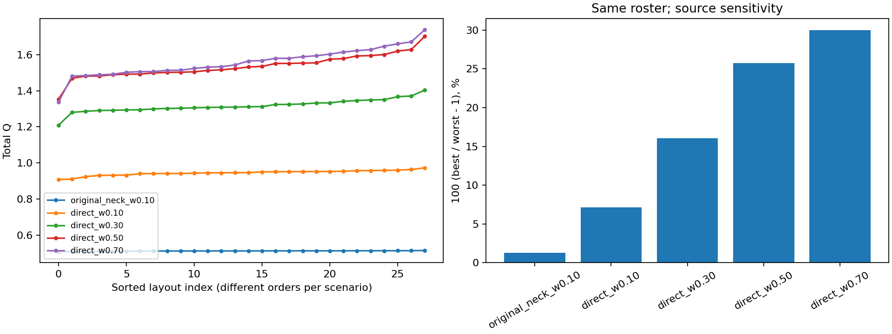

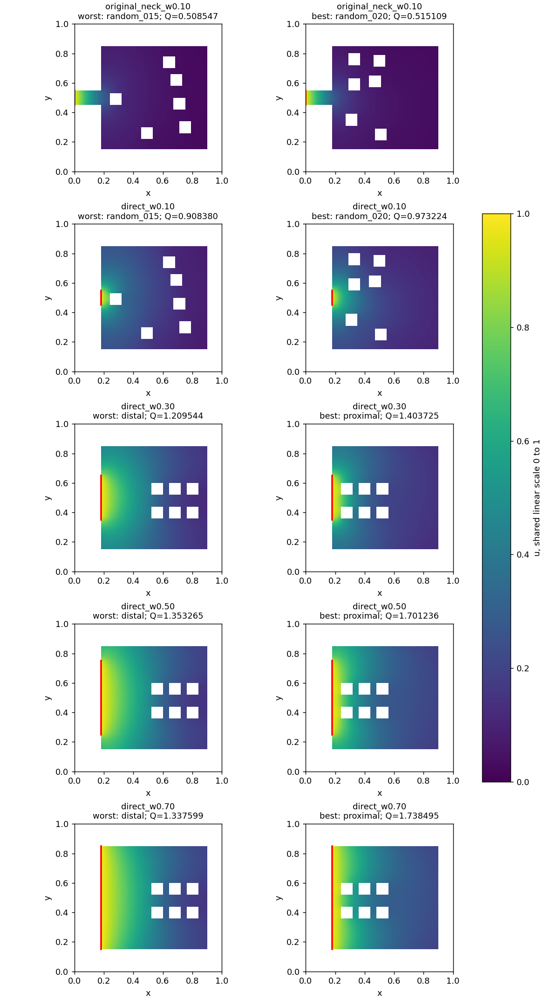

---

## 3. Study II: Equal-Budget Placement Optimization Demo (`budget = 65` Solves)

* **Saved Evidence:** [`results/research_20261022T081921279345Z/report.md`](results/research_20261022T081921279345Z/report.md) · [`method_comparison.csv`](results/research_20261022T081921279345Z/method_comparison.csv)
* **Design:** Freezes the benchmark case `direct_B1_N6` (direct west source width $0.30$, $\mathrm{Bi} = 1.0$, $N = 6$) and compares **random search (`random`)**, **greedy single-hole relocation (`greedy`)**, and **simulated annealing (`anneal`)** across 3 seeds (`81201..81203`) with a strict budget of **65 charged PDE solves per run**, starting from identical initial layouts per seed, followed by $n = 200$ and $n = 400$ mesh refinement.

| Optimizer (`budget = 65`) | Seeds | Median Fine Gain vs. Paired Initial ($n=400$) | Gain Range Across Seeds ($n=400$) | Median vs. Strongest Named Baseline (`proximal`) | Mesh-Stable Paired Gaps ($n=200 \to 400$) |
|---|---:|---:|---:|---:|---:|
| **`random`** | 3 | $+2.827\%$ | $[+0.504\%, +7.082\%]$ | $-1.939\%$ | $3/3$ |
| **`greedy`** | 3 | $+4.898\%$ | $[+3.630\%, +6.817\%]$ | $+0.060\%$ | $3/3$ |
| **`anneal`** | 3 | **$+5.332\%$** | $[+3.202\%, +8.320\%]$ | **$+0.693\%$** | $3/3$ |

* **Physical mechanism of the winning arc design (`anneal_81203`, $Q = 1.445368$ at $n=400$):**
  * The hand-designed `proximal` baseline ($Q = 1.424466$) packs all 6 squares in a $2 \times 3$ block right in front of the source, causing the first two columns to screen the third column while leaving the upper and lower diffusive plumes unharvested.
  * Optimization discovers a **crescent/fan arc flanking the source mouth** ($x \in [0.24, 0.26], y \in \{0.21, 0.37, 0.51, 0.71\}$) with two staggered downstream islands ($x \in \{0.38, 0.44\}$), achieving **$+8.32\%$** over its paired initial layout and **$+7.68\%$** over `spread`.

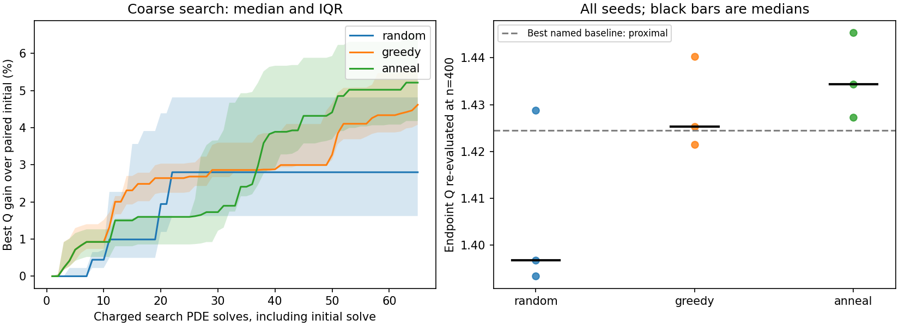

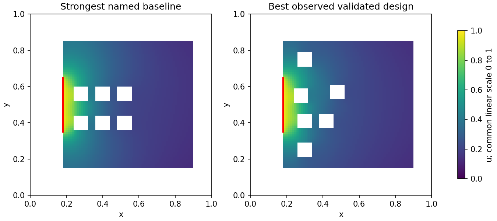

---

## 4. Study III: Full $2 \times 3$ Source-Access $\times$ Permeability ($\mathrm{Bi}$) Regime & Transfer Study

* **Saved Evidence:** [`results/research_20261022T082141365976Z/report.md`](results/research_20261022T082141365976Z/report.md) · [`method_comparison.csv`](results/research_20261022T082141365976Z/method_comparison.csv) · [`mechanisms.json`](results/research_20261022T082141365976Z/mechanisms.json) · [`transfer.csv`](results/research_20261022T082141365976Z/transfer.csv)
* **Scale:** 6 physical cases ($\{\text{direct } w=0.30, \text{neck } w=0.10\} \times \mathrm{Bi} \in \{0.1, 1.0, 10.0\}$ at $N=6$) $\times$ 5 seeds (`81201..81205`) $\times$ 3 optimizers (`random`, `greedy`, `anneal`) $\times$ **129 charged PDE solves per task** = **11,610 nominal search solves** + **802 multi-grid validation solves** ($n=100, 200, 400$) + **18 mechanism diagnostic solves** (12,433 total solves).

### 4.1 Multi-Grid Validated Optimizer Comparison ($n = 400$)

| Case ($N=6$) | Source | $\mathrm{Bi}$ | Optimizer | Median Fine Gain vs. Initial ($n=400$) | Gain Range Across 5 Seeds ($n=400$) | Median vs. Strongest Named Baseline | Mesh-Stable Gaps | Best Validated $Q$ ($n=400$) |
|---|---|---:|---|---:|---:|---:|---:|---:|
| **`direct_B01_N6`** | Direct ($0.30$) | $0.1$ | `random` `greedy` `anneal` | $+0.823\%$ **$+1.892\%$** $+1.537\%$ | $[+0.492\%, +1.650\%]$ $[+1.699\%, +2.319\%]$ $[+1.083\%, +1.821\%]$ | $-0.212\%$ **$+0.982\%$** $+0.426\%$ | $5/5$ $5/5$ $5/5$ | **$0.3601581$** (`greedy_81203`) |
| **`direct_B1_N6`** | Direct ($0.30$) | $1.0$ | `random` `greedy` `anneal` | $+2.827\%$ **$+6.035\%$** $+5.314\%$ | $[+0.504\%, +7.082\%]$ $[+4.406\%, +8.248\%]$ $[+3.683\%, +8.176\%]$ | $-1.913\%$ **$+1.132\%$** $+0.238\%$ | $5/5$ $5/5$ $5/5$ | **$1.4510800$** (`greedy_81201`) |
| **`direct_B10_N6`** | Direct ($0.30$) | $10.0$ | `random` `greedy` `anneal` | $+13.989\%$ **$+20.197\%$** $+18.161\%$ | $[+0.000\%, +24.837\%]$ $[+7.543\%, +33.528\%]$ $[+7.252\%, +30.380\%]$ | $-3.951\%$ **$+2.736\%$** $-0.148\%$ | $5/5$ $5/5$ $5/5$ | **$3.3380264$** (`greedy_81201`) |
| **`neck_B01_N6`** | Neck ($0.10$) | $0.1$ | `random` `greedy` `anneal` | $+0.407\%$ **$+0.686\%$** $+0.458\%$ | $[+0.209\%, +1.402\%]$ $[+0.638\%, +1.652\%]$ $[+0.294\%, +1.626\%]$ | $+0.522\%$ **$+0.846\%$** $+0.625\%$ | $5/5$ $5/5$ $5/5$ | **$0.2309183$** (`greedy_81203`) |
| **`neck_B1_N6`** | Neck ($0.10$) | $1.0$ | `random` `greedy` `anneal` | $+0.178\%$ **$+0.325\%$** $+0.089\%$ | $[+0.130\%, +0.511\%]$ $[+0.279\%, +0.726\%]$ $[+0.055\%, +0.584\%]$ | $+0.197\%$ **$+0.363\%$** $+0.137\%$ | $5/5$ $5/5$ $5/5$ | **$0.5169781$** (`greedy_81205`) |
| **`neck_B10_N6`** | Neck ($0.10$) | $10.0$ | `random` `greedy` `anneal` | $+0.087\%$ **$+0.089\%$** $+0.061\%$ | $[+0.025\%, +0.114\%]$ $[+0.039\%, +0.129\%]$ $[+0.014\%, +0.114\%]$ | $+0.011\%$ **$+0.026\%$** $+0.002\%$ | $5/5$ $5/5$ $5/5$ | **$1.3360111$** (`greedy_81204`) |

---

### 4.2 Mechanism Decomposition (`n = 100` Diagnostics on Each Regime Winner)

To separate **geometric obstruction** from **reactive membrane activation**, each winning layout is evaluated with its 6 islands made purely reflecting ($\partial_n u = 0$, giving $Q_{\text{reflecting}}$) and compared against the empty chamber ($Q_{\text{no\_holes}}$) and reactive-island solution ($Q_{\text{reactive}}$):

| Case | $Q_{\text{no\_holes}}$ | $Q_{\text{reflecting}}$ | $Q_{\text{reactive}}$ | Obstruction $\Delta Q_{\text{obstruction}}$ | Wall Activation $\Delta Q_{\text{activation}}$ | Inner-Island $Q_{\text{inner}}$ | Outer-Wall $Q_{\text{outer}}$ | Inner Share of Total $Q$ |
|---|---:|---:|---:|---:|---:|---:|---:|---:|
| **`direct_B01_N6`** | $0.220301$ | $0.214035$ | $0.358972$ | $-0.006267$ | $+0.144938$ | $0.160871$ | $0.198101$ | **$44.8\%$** |
| **`direct_B1_N6`** | $1.051998$ | $0.913233$ | $1.432247$ | $-0.138766$ | $+0.519014$ | $0.805490$ | $0.626757$ | **$56.2\%$** |
| **`direct_B10_N6`** | $2.079013$ | $1.602801$ | $3.245473$ | $-0.476212$ | $+1.642672$ | $2.433707$ | $0.811766$ | **$75.0\%$** |
| **`neck_B01_N6`** | $0.183650$ | $0.181452$ | $0.230383$ | $-0.002198$ | $+0.048931$ | $0.085010$ | $0.145373$ | **$36.9\%$** |
| **`neck_B1_N6`** | $0.501327$ | $0.492446$ | $0.515652$ | $-0.008881$ | $+0.023206$ | $0.148127$ | $0.367526$ | **$28.7\%$** |
| **`neck_B10_N6`** | $1.324495$ | $1.321655$ | $1.326957$ | $-0.002840$ | $+0.005303$ | $0.101419$ | $1.225539$ | **$7.6\%$** |

> **Why `direct` and `neck` scale in opposite directions with $\mathrm{Bi}$:**
> In `direct_*`, increasing $\mathrm{Bi}$ from $0.1 \to 10$ raises the fraction of total flux captured by the 6 movable inner islands from **$44.8\%$ to $75.0\%$**, amplifying placement gains up to **$+33.53\%$**.
> In `neck_*`, the narrow inlet neck's own walls are Robin-reactive: as $\mathrm{Bi}$ increases from $0.1 \to 10$, the neck walls intercept most of the incoming flux before it exits the neck, dropping the inner islands' share of uptake from **$36.9\%$ down to $7.6\%$** and compressing placement gains to **$< 0.13\%$**.

---

### 4.3 Cross-Regime Generalization & Transfer Matrix (`transfer.csv`)

Each row below takes the winning 6-hole geometry optimized for **Origin Regime** and evaluates its coarse-grid flux $Q$ inside **Target Regime** (reported as percentage difference relative to the target regime's own native winner):

| Origin Winner $\downarrow$ $\backslash$ Target Regime $\rightarrow$ | `direct_B01_N6` | `direct_B1_N6` | `direct_B10_N6` | `neck_B01_N6` | `neck_B1_N6` | `neck_B10_N6` |
|---|---:|---:|---:|---:|---:|---:|
| **`direct_B01_N6` (`greedy_81203`)** | **$0.000\%$** | $-0.175\%$ | $-8.631\%$ | $-1.119\%$ | $-0.580\%$ | $-0.053\%$ |
| **`direct_B1_N6` (`greedy_81201`)** | $-0.334\%$ | **$0.000\%$** | $-5.680\%$ | $-1.243\%$ | $-0.558\%$ | $-0.049\%$ |
| **`direct_B10_N6` (`greedy_81201`)** | $-1.919\%$ | $-2.524\%$ | **$0.000\%$** | $-2.374\%$ | $-0.966\%$ | $-0.030\%$ |
| **`neck_B01_N6` (`greedy_81203`)** | $-0.637\%$ | $-4.232\%$ | $-22.941\%$ | **$0.000\%$** | $-0.075\%$ | $-0.128\%$ |
| **`neck_B1_N6` (`greedy_81205`)** | $-0.976\%$ | $-2.731\%$ | $-12.633\%$ | $-0.305\%$ | **$0.000\%$** | $-0.090\%$ |
| **`neck_B10_N6` (`greedy_81204`)** | *Infeasible*\* | *Infeasible*\* | *Infeasible*\* | $-2.935\%$ | $-1.242\%$ | **$0.000\%$** |

*\*Note: `neck_B10_N6` places two islands at `col = 22` flanking the recessed neck opening; in the flat-walled `direct_*` domain, those coordinates violate the protected source collar.*

* **No single universal layout exists across $\mathrm{Bi}$:**
  * A layout optimized for weak screening ($\mathrm{Bi}=0.1$) spreads islands across $y \in [0.21, 0.79]$; when placed in a strong-screening regime ($\mathrm{Bi}=10$), its distal islands sit in depleted dead zones, losing **$-8.63\%$** (and **$-22.94\%$** from `neck_B01_N6`).
  * Conversely, the tightly clustered $\mathrm{Bi}=10$ shield over-screens itself when transferred to $\mathrm{Bi}=0.1$, losing **$-1.92\%$** relative to the spread-out $\mathrm{Bi}=0.1$ winner.

---

### 4.4 Visual Comparison Across Regimes

#### Direct Source ($\mathrm{Bi} = 0.1, 1.0, 10.0$)
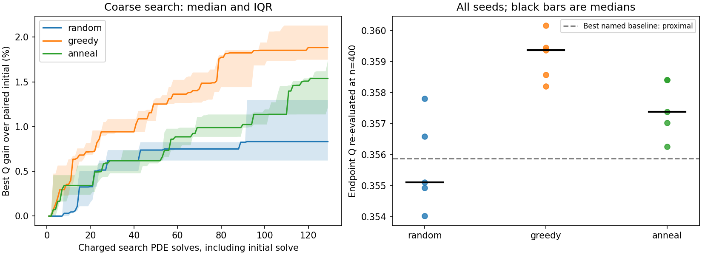
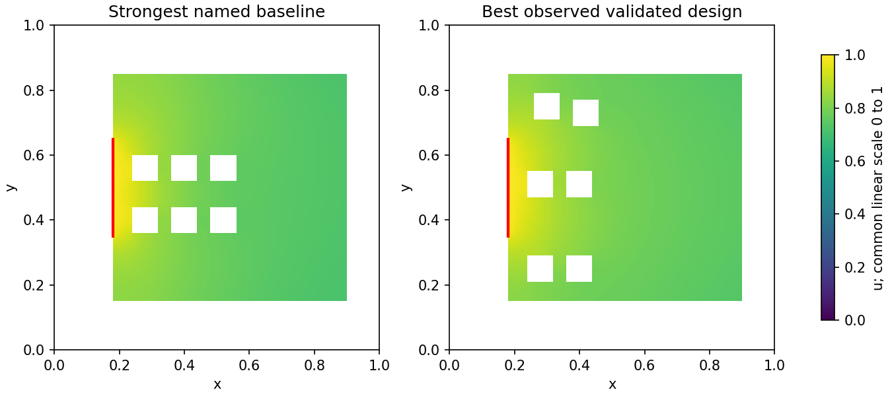

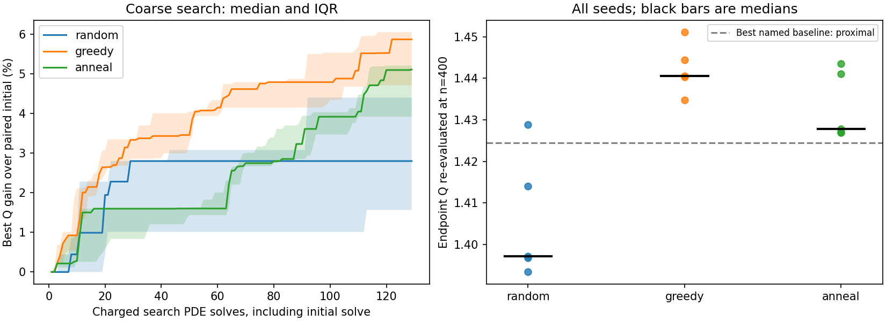
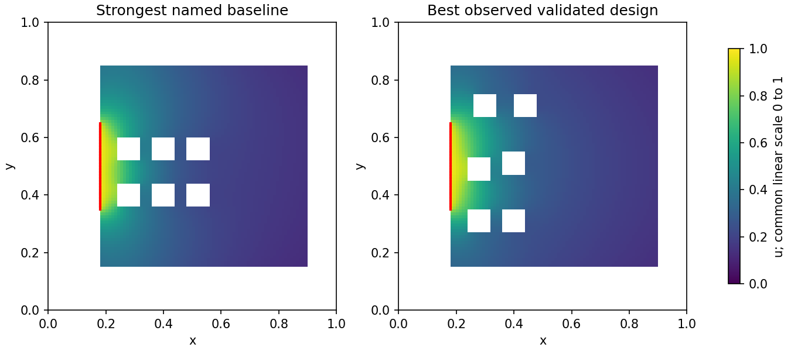

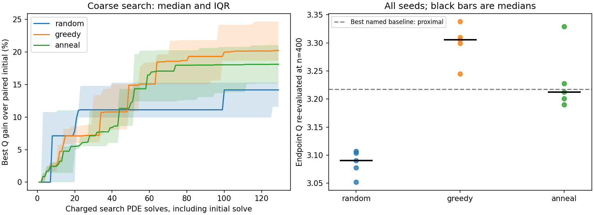
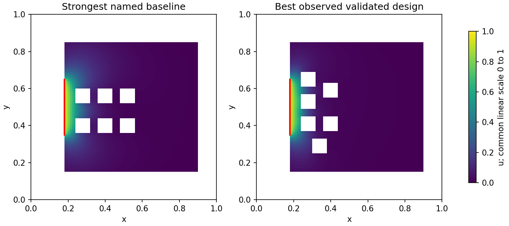

#### Narrow Neck Source ($\mathrm{Bi} = 0.1, 1.0, 10.0$)
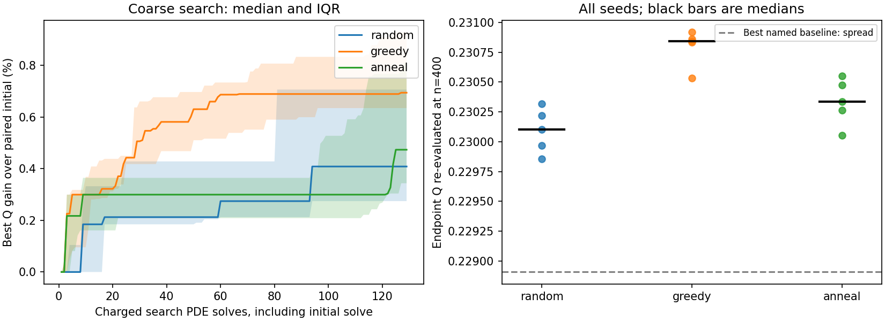
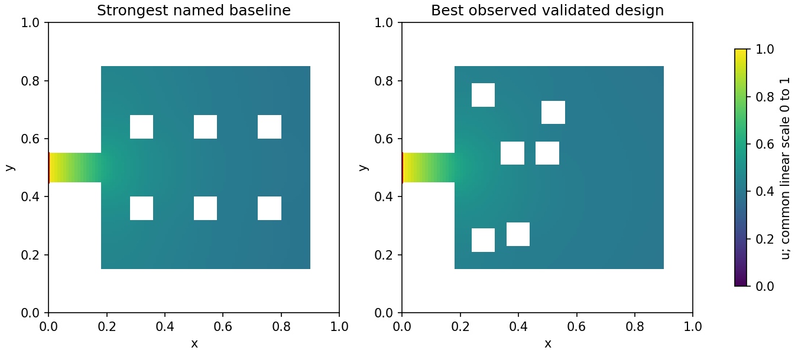

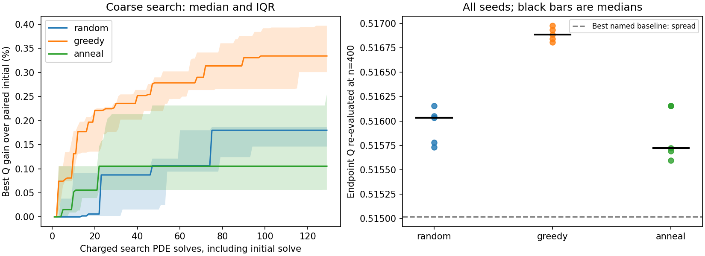
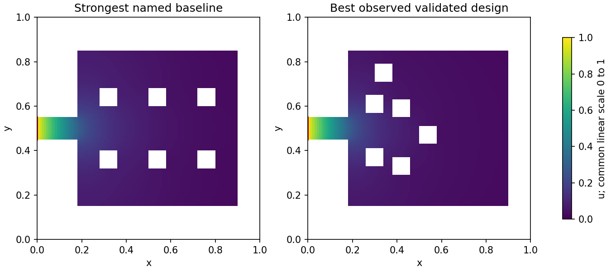

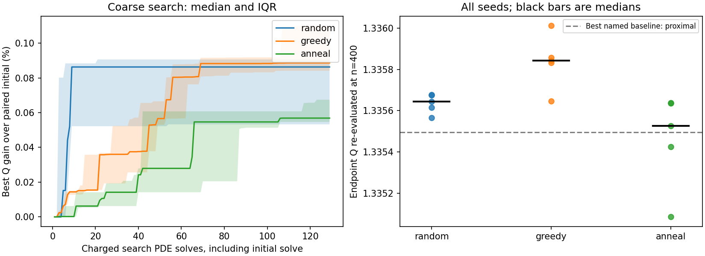
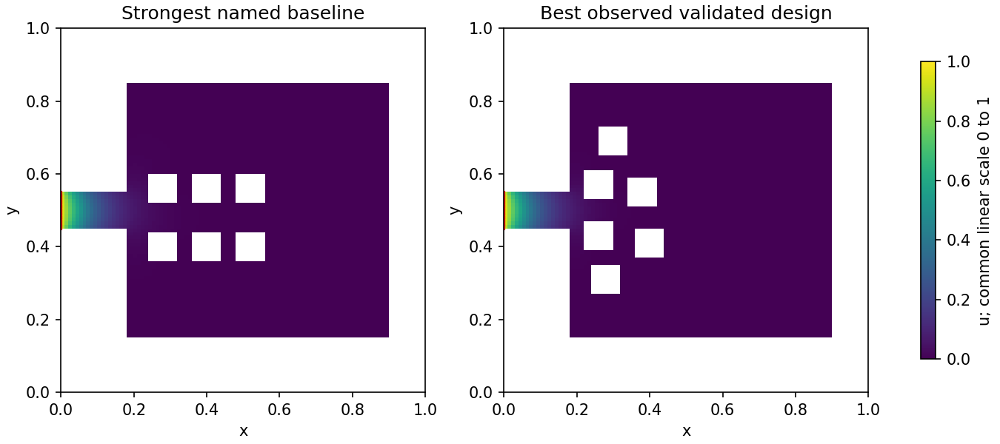

---

## 5. Study IV: Conducting-Duct Neck, Constant-Perimeter Subdivision, $N$-Sweep & Independent P1 FEM (`n = 400` + FEM)

* **Saved Evidence:** [`results/research_20261022T132031384663Z/report.md`](results/research_20261022T132031384663Z/report.md) · [`method_comparison.csv`](results/research_20261022T132031384663Z/method_comparison.csv) · [`fem_validation.csv`](results/research_20261022T132031384663Z/fem_validation.csv) · [`mechanisms.json`](results/research_20261022T132031384663Z/mechanisms.json)
* **Scale:** 9 cases $\times$ 3 seeds $\times$ 3 optimizers $\times$ 65 solves = **5,265 search solves** + **426 multi-grid FVM solves** ($n=100, 200, 400$) + **252 independent conforming P1 FEM solves** (`triangle`, `max_area = 0.0005, 0.0002`) + **27 mechanism diagnostic solves**.

### 5.1 Conducting (Neumann) Neck vs. Reactive (Robin) Neck (`N = 6`)

In Study III, the narrow inlet neck's own walls were Robin-reactive (`neck_*`), absorbing $92.4\%$ of the flux at $\mathrm{Bi}=10$ before molecules could enter the chamber. Here (`cneck_*`), the inlet neck walls are made **reflecting/non-absorbing ($\partial_n u = 0$, modeling a conducting airway/duct)** while the main chamber and 6 islands remain Robin-reactive ($P_{\text{Robin}} = 4.66$, identical to `direct` width $0.10$):

| $\mathrm{Bi}$ | Reactive Neck (`neck_*`) `greedy` Median Gain | Conducting Neck (`cneck_*`) `greedy` Median Gain | Reactive Neck Inner-Island Share of $Q$ | Conducting Neck Inner-Island Share of $Q$ | Conducting Neck Best $Q$ ($n=400$) |
|---:|---:|---:|---:|---:|---:|
| **$0.1$** | $+0.686\%$ | **$+1.649\%$** ($[+1.25\%, +1.67\%]$) | $36.9\%$ | **$42.1\%$** | $0.2068747$ |
| **$1.0$** | $+0.325\%$ | **$+1.164\%$** ($[+1.15\%, +1.30\%]$) | $28.7\%$ | **$48.8\%$** | $0.3545258$ |
| **$10.0$** | $+0.089\%$ | **$+2.565\%$** ($[+2.50\%, +2.68\%]$) | $7.6\%$ | **$66.3\%$** | $0.4250992$ |

* **Physical takeaway:** Passivating the inlet neck (`conducting_neck`) restores inner-island uptake at $\mathrm{Bi}=10$ from **$7.6\%$ up to $66.3\%$** of total flux and increases placement optimization gains nearly **$30\times$** (from $0.089\%$ to **$2.565\%$**). The remaining gap between `cneck_B10_N6` ($2.57\%$) and `direct_B10_N6` ($20.20\%$) is due to the pure diffusive series resistance ($R_{\text{duct}} \approx L_{\text{duct}}/w_{\text{duct}} = 1.8$) of the narrow conducting duct.

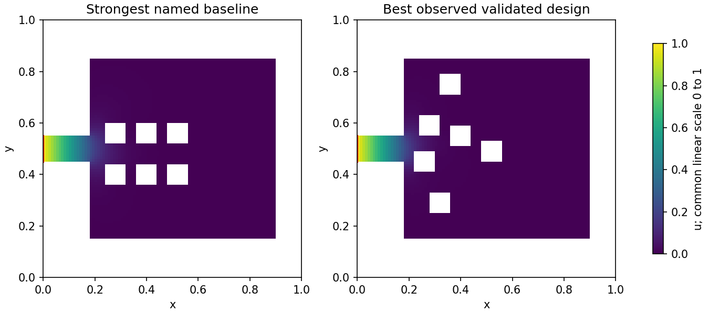

---

### 5.2 Constant-Perimeter Subdivision vs. Fixed-Square-Size $N$-Sweep (`Bi = 1.0`, Direct Width `0.30`)

We compare two distinct resource policies across $N$:
1. **Constant Total Membrane Perimeter ($P_{\text{Robin}} = 4.46$, added island perimeter $4 N s = 1.92$ held strictly constant):** compares few large islands ($N=3, s=0.16$) against more smaller islands ($N=4, s=0.12$; $N=6, s=0.08$; $N=8, s=0.06$).
2. **Fixed Island Square Size ($s = 0.08$, where each added island adds $+0.32$ perimeter and removes $0.0064$ air area):** sweeps $N \in \{2, 4, 6, 8\}$.

| Resource Policy | Case | $N$ | Island Side $s$ | Air Area $A_{\text{air}}$ | Total Perimeter $P_{\text{Robin}}$ | `greedy` Median Gain ($n=400$) | Obstruction $\Delta Q_{\text{obstruction}}$ | Best Validated $Q$ ($n=400$) |
|---|---|---:|---:|---:|---:|---:|---:|---:|
| **Constant Perimeter ($4Ns = 1.92$)** | `constP_B1_N3_s016` | $3$ | $0.16$ | $0.4272$ | **$4.46$** | $+2.357\%$ | $-0.168099$ | $1.2902423$ |
| **Constant Perimeter ($4Ns = 1.92$)** | `constP_B1_N4_s012` | $4$ | $0.12$ | $0.4464$ | **$4.46$** | $+5.413\%$ | $-0.180454$ | $1.3651684$ |
| **Constant Perimeter ($4Ns = 1.92$)** | `direct_B1_N6` (Study II) | $6$ | $0.08$ | $0.4656$ | **$4.46$** | $+4.898\%$ | $-0.144580$ | $1.4453678$ |
| **Constant Perimeter ($4Ns = 1.92$)** | `constP_B1_N8_s006` | $8$ | $0.06$ | $0.4752$ | **$4.46$** | **$+9.917\%$** | **$-0.101617$** | **$1.4897968$** |
| **Fixed Square Size ($s = 0.08$)** | `fixedS_B1_N2_s008` | $2$ | $0.08$ | $0.4912$ | $3.18$ | $+8.506\%$ | $-0.100598$ | $1.2839753$ |
| **Fixed Square Size ($s = 0.08$)** | `fixedS_B1_N4_s008` | $4$ | $0.08$ | $0.4784$ | $3.82$ | **$+10.802\%$** | $-0.141789$ | $1.3861472$ |
| **Fixed Square Size ($s = 0.08$)** | `direct_B1_N6` (Study II) | $6$ | $0.08$ | $0.4656$ | $4.46$ | $+4.898\%$ | $-0.144580$ | $1.4453678$ |
| **Fixed Square Size ($s = 0.08$)** | `fixedS_B1_N8_s008` | $8$ | $0.08$ | $0.4528$ | $5.10$ | $+4.817\%$ | $-0.149116$ | $1.4697841$ |

* **Key discovery 1 — Subdividing fixed membrane perimeter into smaller islands boosts uptake by $+15.5\%$:**
  * Holding total reactive perimeter fixed at $P_{\text{Robin}} = 4.46$, splitting 3 large islands ($s=0.16, Q=1.2902$) into 8 small islands ($s=0.06, Q=1.4898$) increases total uptake by **$+15.47\%$**, because excluded blockage area shrinks as $N s^2 \propto 1/N$ (halving obstruction loss $\Delta Q_{\text{obstruction}}$ from $-0.1681$ to $-0.1016$) while allowing a finer multi-tiered sieve around the inlet plume.
* **Key discovery 2 — Less membrane can absorb more flux when crowding is reduced:**
  * Compare `constP_B1_N8_s006` ($N=8, s=0.06, P_{\text{Robin}} = 4.46, Q = \mathbf{1.4898}$) against `fixedS_B1_N8_s008` ($N=8, s=0.08, P_{\text{Robin}} = 5.10, Q = \mathbf{1.4698}$). Despite having **$12.5\%$ less total reactive perimeter** ($4.46$ vs. $5.10$), the eight $s=0.06$ islands achieve **higher total flux** than the eight $s=0.08$ islands because smaller islands pack closer to the high-concentration inlet arc without choking off the flow channels between islands.

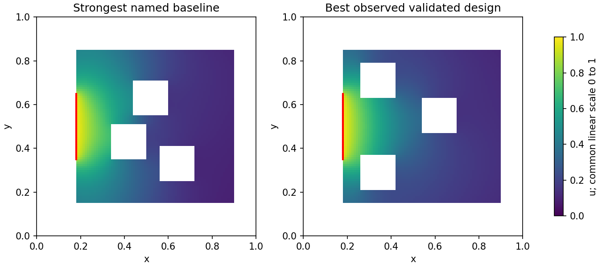
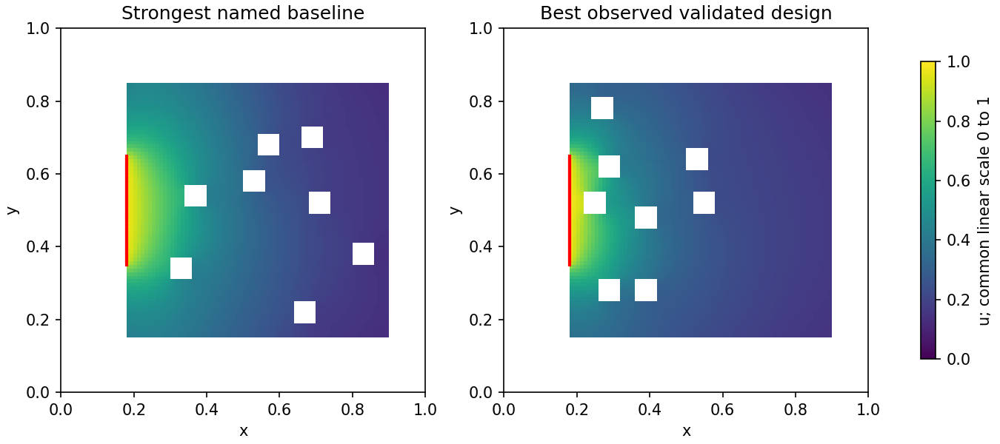
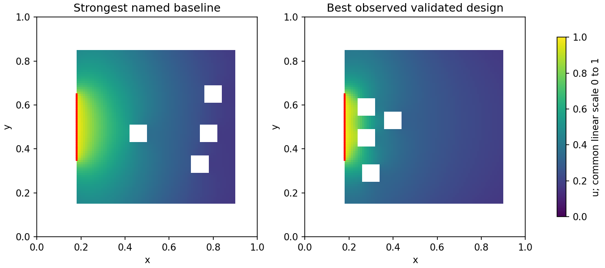

---

### 5.3 Independent Conforming P1 FEM Cross-Check (`fem_validation.csv`)

Every unique candidate across all 9 cases in Study IV was meshed with `triangle` (`max_area = 0.0005` and `0.0002`, $\sim 2,045\text{--}2,299$ vertices) and solved with an independent conforming P1 finite-element assembly:

| Case | Finest FVM $Q$ ($n=400$) | Independent P1 FEM $Q$ (`max_area = 0.0002`) | FEM vs. $n=400$ FVM Difference | FEM Mesh Vertices |
|---|---:|---:|---:|---:|
| **`cneck_B01_N6`** | $0.2068747$ | $0.2079100$ | $+0.500\%$ | $2,295$ |
| **`cneck_B1_N6`** | $0.3545258$ | $0.3579786$ | $+0.974\%$ | $2,292$ |
| **`cneck_B10_N6`** | $0.4250992$ | $0.4305853$ | $+1.291\%$ | $2,299$ |
| **`constP_B1_N3_s016`** | $1.2902423$ | $1.3180751$ | $+2.157\%$ | $2,045$ |
| **`constP_B1_N4_s012`** | $1.3651684$ | $1.3989082$ | $+2.471\%$ | $2,114$ |
| **`constP_B1_N8_s006`** | $1.4897968$ | $1.5308566$ | $+2.756\%$ | $2,234$ |
| **`fixedS_B1_N2_s008`** | $1.2839753$ | $1.3154822$ | $+2.454\%$ | $2,183$ |
| **`fixedS_B1_N4_s008`** | $1.3861472$ | $1.4288777$ | $+3.083\%$ | $2,198$ |
| **`fixedS_B1_N8_s008`** | $1.4697841$ | $1.5126056$ | $+2.913\%$ | $2,201$ |

