# Research results

Status: complete

## cneck_B01_N6

N=6, hole_width=0.08, Bi=0.1, source=conducting_neck, width=0.1. Best observed validated design: greedy_81203; Q=0.2068747 at n=400.

| Method | Median fine gain vs paired initial | Median vs strongest named baseline |
|---|---:|---:|
| random | 1.227% | 0.470% |
| greedy | 1.649% | 0.889% |
| anneal | 1.318% | 0.572% |

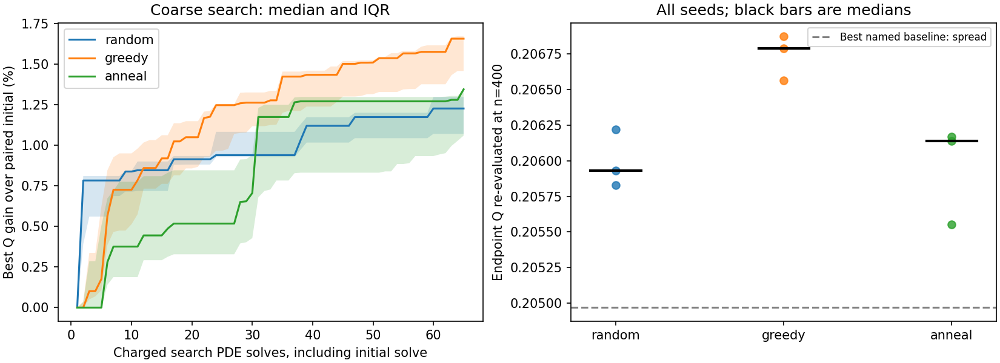

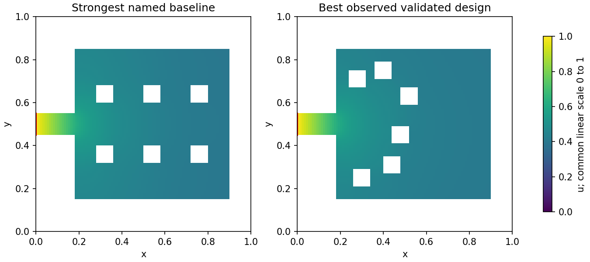

## cneck_B1_N6

N=6, hole_width=0.08, Bi=1, source=conducting_neck, width=0.1. Best observed validated design: greedy_81202; Q=0.3545258 at n=400.

| Method | Median fine gain vs paired initial | Median vs strongest named baseline |
|---|---:|---:|
| random | 0.786% | 0.235% |
| greedy | 1.164% | 0.666% |
| anneal | 0.978% | 0.412% |

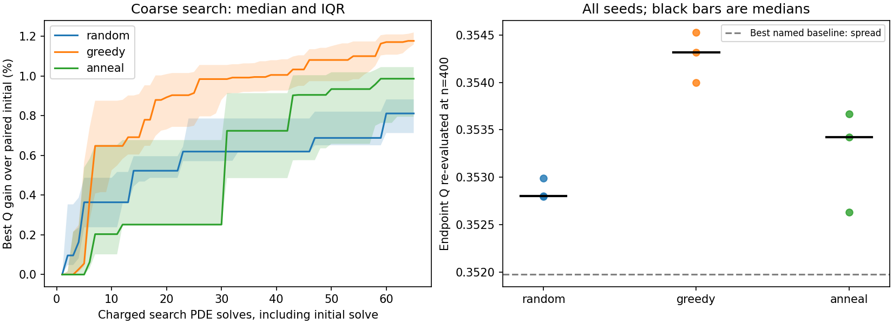

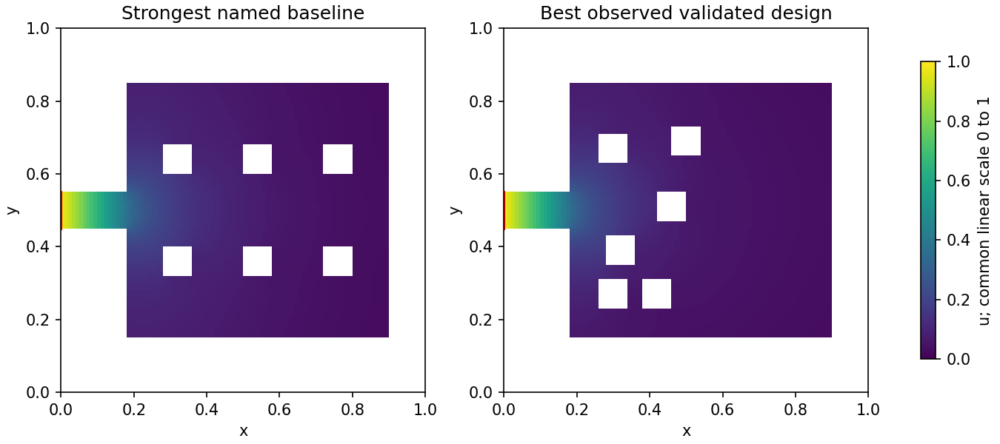

## cneck_B10_N6

N=6, hole_width=0.08, Bi=10, source=conducting_neck, width=0.1. Best observed validated design: greedy_81203; Q=0.4250992 at n=400.

| Method | Median fine gain vs paired initial | Median vs strongest named baseline |
|---|---:|---:|
| random | 2.538% | 0.368% |
| greedy | 2.565% | 0.394% |
| anneal | 2.395% | 0.426% |

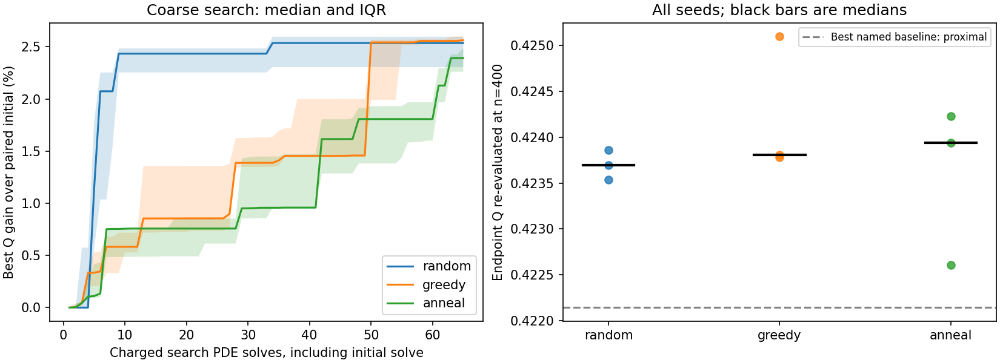

## constP_B1_N3_s016

N=3, hole_width=0.16, Bi=1, source=direct, width=0.3. Best observed validated design: anneal_81203; Q=1.2902423 at n=400.

| Method | Median fine gain vs paired initial | Median vs strongest named baseline |
|---|---:|---:|
| random | 1.460% | 3.039% |
| greedy | 2.357% | 3.622% |
| anneal | 2.455% | 3.874% |

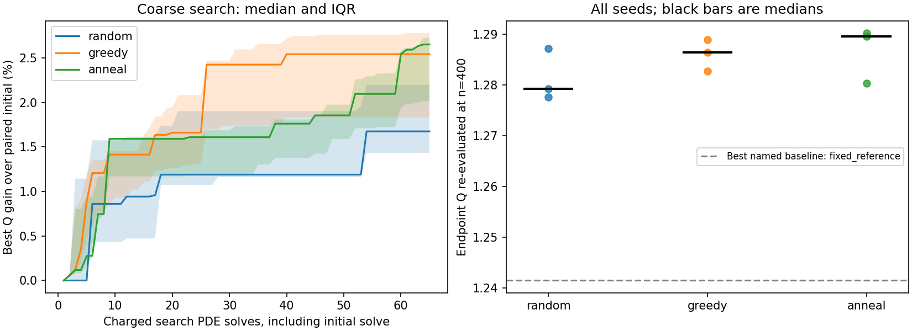

## constP_B1_N4_s012

N=4, hole_width=0.12, Bi=1, source=direct, width=0.3. Best observed validated design: random_81202; Q=1.3651684 at n=400.

| Method | Median fine gain vs paired initial | Median vs strongest named baseline |
|---|---:|---:|
| random | 5.074% | 2.069% |
| greedy | 5.413% | 2.123% |
| anneal | 5.978% | 2.670% |

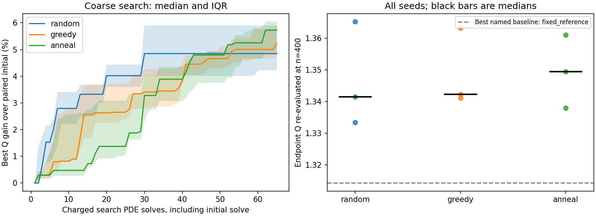

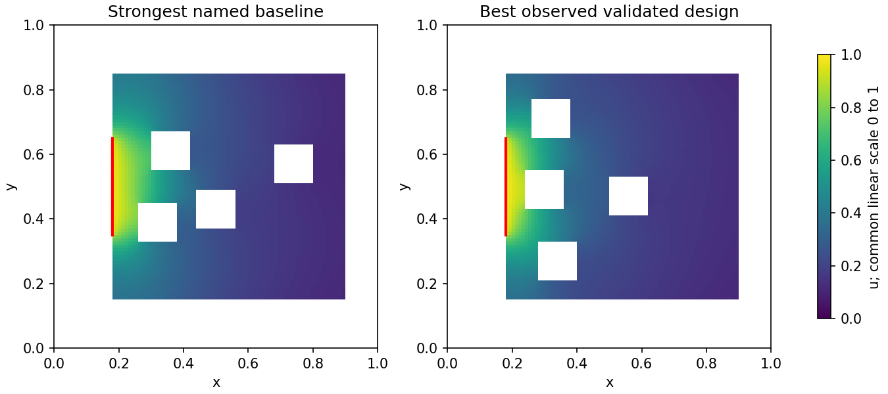

## constP_B1_N8_s006

N=8, hole_width=0.06, Bi=1, source=direct, width=0.3. Best observed validated design: greedy_81203; Q=1.4897968 at n=400.

| Method | Median fine gain vs paired initial | Median vs strongest named baseline |
|---|---:|---:|
| random | 7.189% | 10.356% |
| greedy | 9.917% | 12.669% |
| anneal | 7.358% | 10.045% |

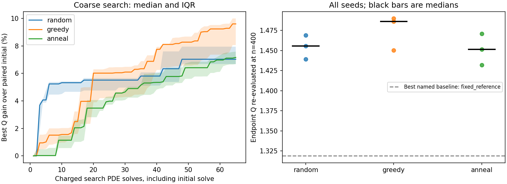

## fixedS_B1_N2_s008

N=2, hole_width=0.08, Bi=1, source=direct, width=0.3. Best observed validated design: anneal_81202; Q=1.2839753 at n=400.

| Method | Median fine gain vs paired initial | Median vs strongest named baseline |
|---|---:|---:|
| random | 5.235% | 7.022% |
| greedy | 8.506% | 9.149% |
| anneal | 8.610% | 9.356% |

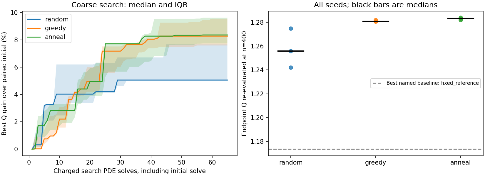

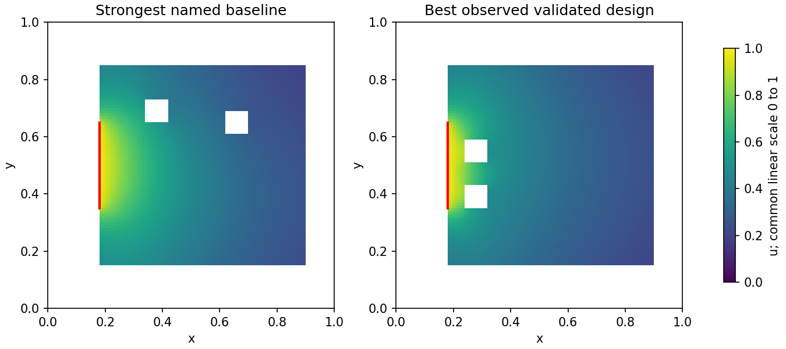

## fixedS_B1_N4_s008

N=4, hole_width=0.08, Bi=1, source=direct, width=0.3. Best observed validated design: greedy_81202; Q=1.3861472 at n=400.

| Method | Median fine gain vs paired initial | Median vs strongest named baseline |
|---|---:|---:|
| random | 8.156% | 11.381% |
| greedy | 10.802% | 15.763% |
| anneal | 10.144% | 14.989% |

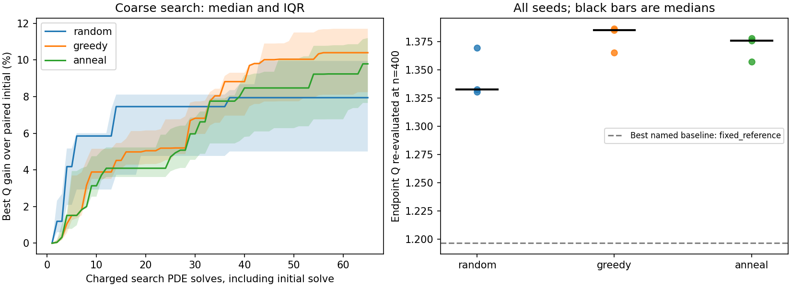

## fixedS_B1_N8_s008

N=8, hole_width=0.08, Bi=1, source=direct, width=0.3. Best observed validated design: anneal_81203; Q=1.4697841 at n=400.

| Method | Median fine gain vs paired initial | Median vs strongest named baseline |
|---|---:|---:|
| random | 3.274% | 9.062% |
| greedy | 4.817% | 10.117% |
| anneal | 4.877% | 8.038% |

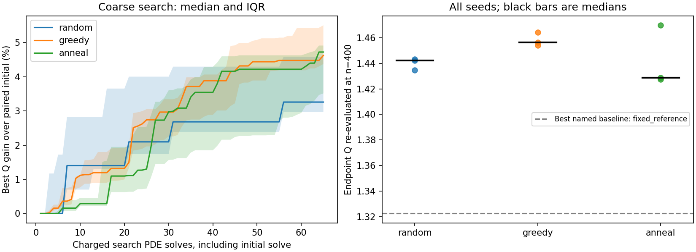

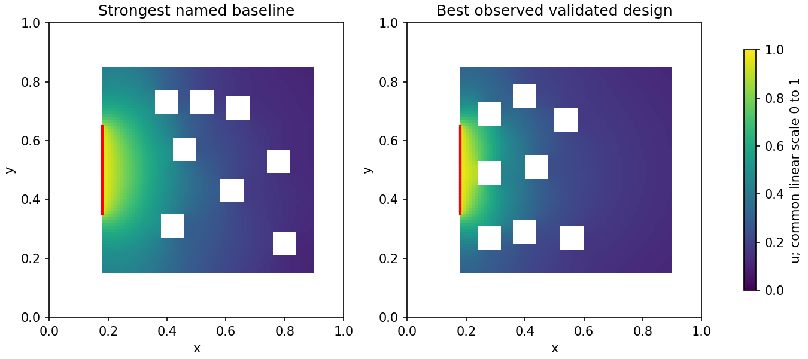

## Independent FEM cross-check

| Case | FEM Q | FEM vs finest FVM | FEM vertices |
|---|---:|---:|---:|
| cneck_B01_N6 | 0.2079100 | 0.500% | 2295 |
| cneck_B1_N6 | 0.3579786 | 0.974% | 2292 |
| cneck_B10_N6 | 0.4305853 | 1.291% | 2299 |
| constP_B1_N3_s016 | 1.3180751 | 2.157% | 2045 |
| constP_B1_N4_s012 | 1.3989082 | 2.471% | 2114 |
| constP_B1_N8_s006 | 1.5308566 | 2.756% | 2234 |
| fixedS_B1_N2_s008 | 1.3154822 | 2.454% | 2183 |
| fixedS_B1_N4_s008 | 1.4288777 | 3.083% | 2198 |
| fixedS_B1_N8_s008 | 1.5126056 | 2.913% | 2201 |

This is an exploratory finite-budget comparison. Gains use paired starts; method ranking uses all seeds. Source width 0.30 was chosen after the earlier pilot. The demo seeds have not been used to tune the present optimizer. Seed ranges and IQRs describe search variability, not confidence intervals for a global optimum. Mesh-stable means the change in the last two paired flux differences is below the configured fraction of the finest difference; it is a screening criterion, not a rigorous error bound. A fixed-square-size N sweep changes air area and membrane length across N. Keep comparisons within a case separate from comparisons between physical cases.

Status: complete. Paid solves by phase: {'search': 5265, 'validation_fvm': 426, 'validation_fem': 252, 'mechanism_fvm': 27}. Four initial analytical/linearity check solves are separate.